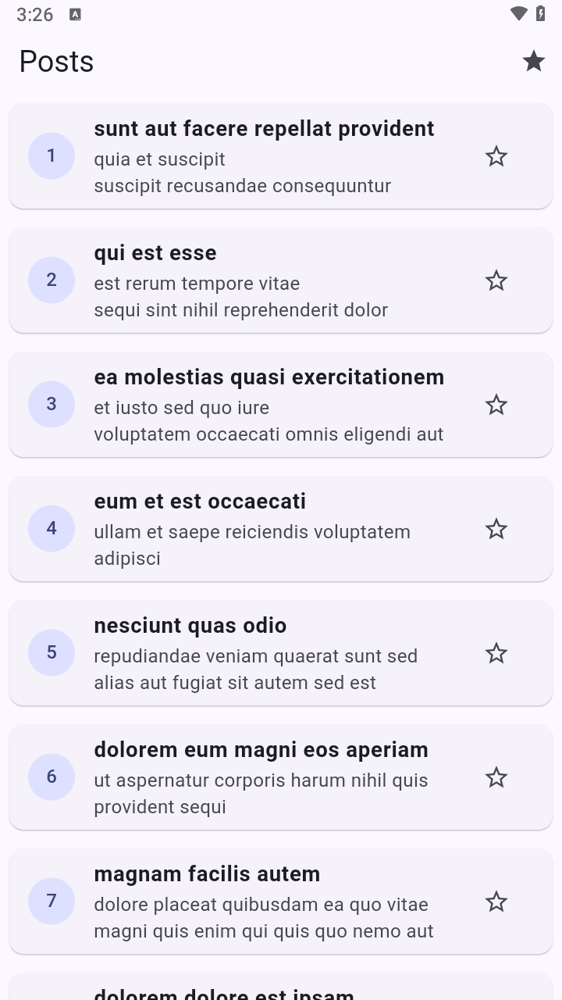
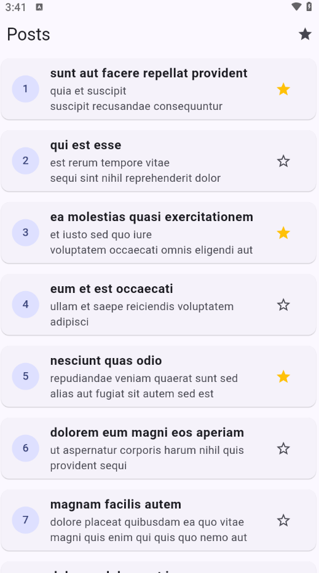
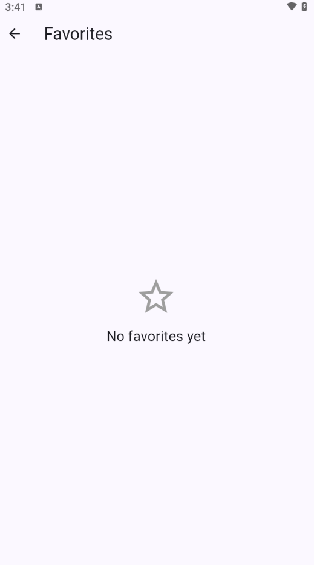
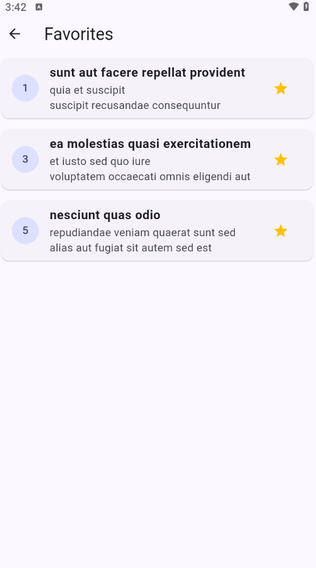

# Offline Posts App with Hive

Flutter Lab, Section 5. Posts app that fetches from an API, caches everything in a local
Hive database, and keeps working with no internet. Part 3 adds a Favorites box.

**Abdelrahman Hany - 23010078**

## What it does

The app loads 100 posts from `https://jsonplaceholder.typicode.com/posts`. Every time it
loads them it also writes them into a Hive box, so the next time there is no internet it
reads the box instead and the list still appears.

```
Online   INTERNET -> API -> Hive -> ListView
Offline  Hive -> ListView
```

You can star any post. Favorites are saved in their own Hive box and survive a refresh,
an app restart and airplane mode.

## Screenshots

### 1. Posts loaded from the API


### 2. Console confirms it cached to Hive


### 3. Tapping the star marks a favorite
The star fills in straight away, no reload needed.



### 4. The Favorites screen
Opened from the star button in the AppBar.


### 5. Empty state


### 6. Airplane mode, posts still load


### 7. Console confirms it came from Hive


### 8. Favorites survive offline and restart


## Project structure

```
lib/
├── main.dart                        starts Hive, registers the adapter, opens both boxes
├── models/
│   ├── post_model.dart              the Post class with Hive annotations
│   └── post_model.g.dart            generated adapter, do not edit
├── services/
│   ├── post_service.dart            API first, Hive as the fallback
│   └── favorites_service.dart       toggleFavorite, isFavorite, getFavorites
├── screens/
│   ├── posts_screen.dart            the list, the star button, the AppBar action
│   └── favorites_screen.dart        saved favorites and the empty state
└── widgets/
    └── post_card.dart               one card used by both screens
```

The screen never calls `http` or `Hive` itself. It asks a service. That way if the storage
or the API changes later, only the service changes.

## The two boxes

| Box | Holds | Why it is separate |
|---|---|---|
| `postsBox` | the 100 posts from the API | cleared and rewritten on every refresh |
| `favoritesBox` | only the posts you starred | `postsBox.clear()` would otherwise delete your favorites |

Both are opened once in `main.dart` before `runApp`, so every read after that is
synchronous.

## How favorites work

The post `id` is the key, so checking and removing are both direct lookups:

```dart
bool isFavorite(int id) => _box.containsKey(id);

Future<void> toggleFavorite(Post post) async {
  if (isFavorite(post.id)) {
    await _box.delete(post.id);
  } else {
    await _box.put(post.id, post.copy());
  }
}
```

`post.copy()` matters. `Post` extends `HiveObject` and a HiveObject can only live in one
box at a time, so putting the same instance that is already in `postsBox` into
`favoritesBox` throws. Saving a new object with the same values avoids that.

Both screens wrap their list in a `ValueListenableBuilder` on
`Hive.box<Post>('favoritesBox').listenable()`, which is why the star changes the moment it
is tapped and the Favorites screen updates with no manual `setState`.

## How getPosts decides what to return

1. Open `postsBox`
2. Try the API
3. Worked: clear the box, save the new posts, return them
4. Failed: if the box has data return it, otherwise throw `No Internet and No Cached Data`

## Running it

```bash
flutter pub get
dart run build_runner build --delete-conflicting-outputs
flutter run
```

The second line generates `post_model.g.dart`, which contains `PostAdapter`.

## Testing offline mode

| # | Action | Expected |
|---|---|---|
| 1 | Run with internet on | Posts load, console prints `Loaded from API and cached to Hive: 100` |
| 2 | Star a few posts, close the app, turn on airplane mode | |
| 3 | Open it again | Posts still appear, console prints `Loaded from Hive offline: 100`, favorites still starred |
| 4 | Uninstall, airplane mode, run | `Error: No Internet and No Cached Data` |

## Packages

| Package | Used for |
|---|---|
| `hive`, `hive_flutter` | the local database and `ValueListenableBuilder` |
| `hive_generator`, `build_runner` | generating the TypeAdapter |
| `http` | calling the API |
| `connectivity_plus` | listed in the lab setup |
